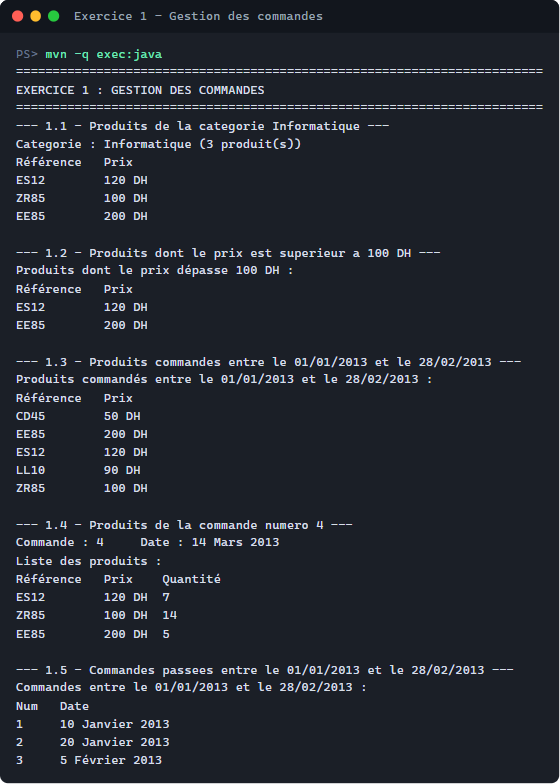
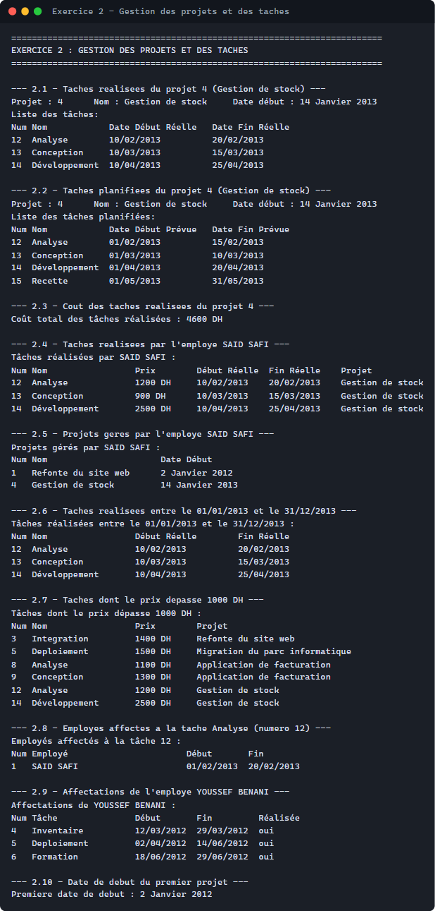
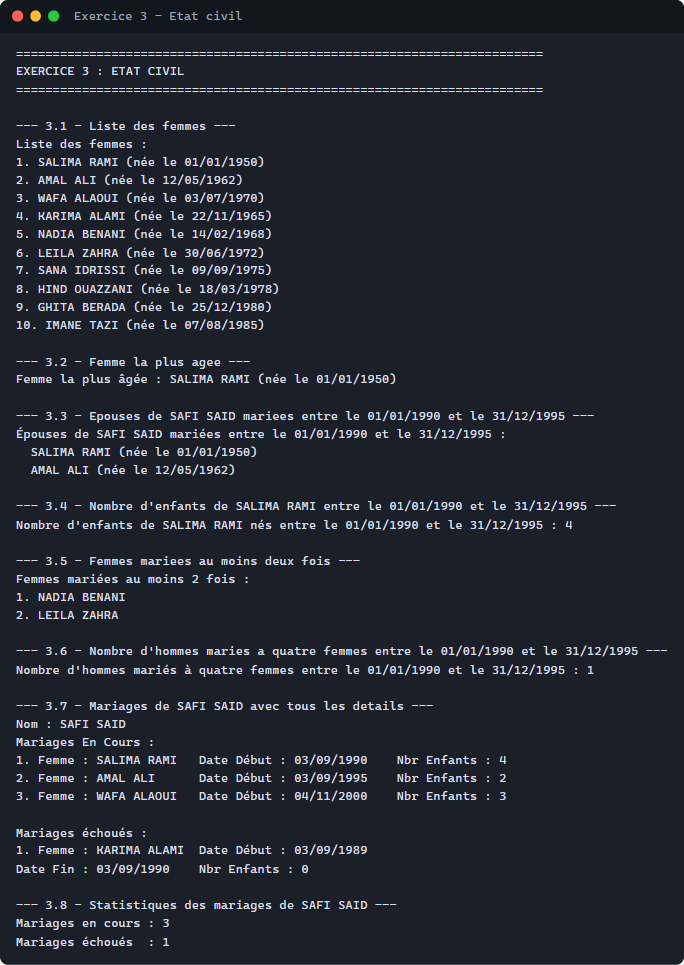
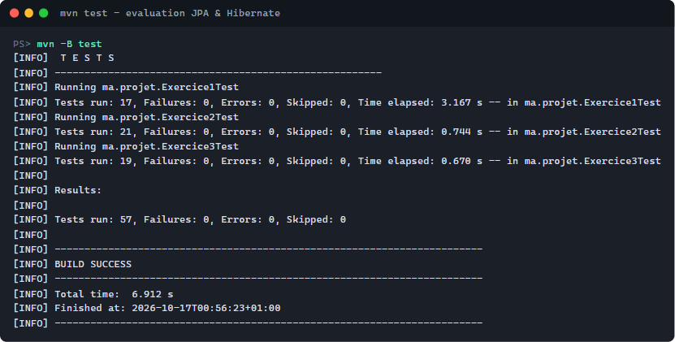

# Évaluation — JPA & Hibernate : gestion de stock, gestion de projets et état civil

## Exercice 1 — Gestion de stock

## Exercice 2 — Gestion de projets et des tâches

## Exercice 3 — État civil

## Tests unitaires (57 tests, 0 échec)

